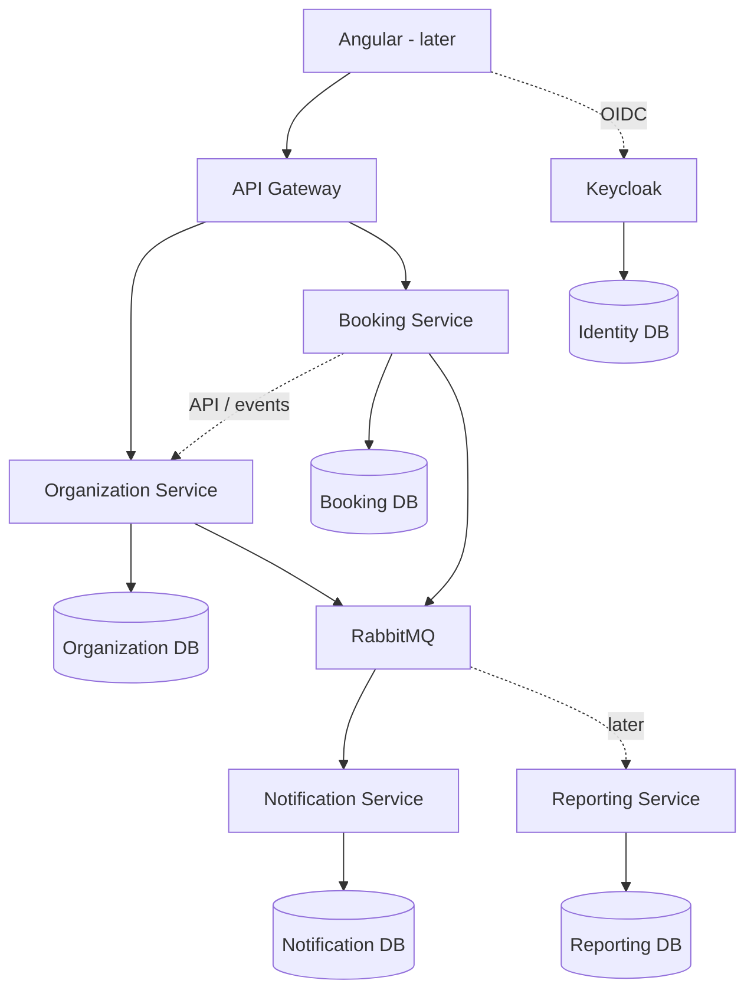

# BookFlow — target architecture
Status: proposed, not implemented. Microservices selected explicitly by developer; remaining choices are recommendations to validate in BF-002.

## Boundaries
- Gateway: routing and edge concerns; not the sole security boundary.
- Keycloak: authentication and token issuance; not the source of business memberships.
- Organization: tenants, memberships and employees.
- Booking: catalog, employee-service assignments, schedules, availability and appointments. Keep scheduling and booking together to enforce overlap invariants locally.
- Notification: email delivery, reminders, retry and delivery state.
- Reporting: later event-driven read models.

## Design principles
Database per service (separate logical databases and credentials can share a local PostgreSQL instance); independent builds/deployments within monorepo; no shared persistence entities; synchronous APIs for immediate answers and asynchronous events for side effects. Use transactional outbox when publishing durable business events, idempotent consumers, bounded retries and dead-letter handling. Eventual consistency is acceptable only where business rules permit it. Booking concurrency needs database-backed protection, not just a pre-insert check; evaluate PostgreSQL exclusion constraints or locking in the design phase.

Validate JWT issuer/audience and tenant membership per service. Decide how employee changes propagate and how stale data is handled before implementing cross-service workflows. Never assume tenant IDs supplied by clients are authorized.

## Planned ADRs
ADR-001 Microservices vs modular monolith; ADR-002 Monorepo vs polyrepo; ADR-003 Database per service; ADR-004 Keycloak; ADR-005 Sync and async communication; ADR-006 Docker Compose. Each should record context, alternatives, decision, consequences and status. Do not treat these as already written or approved.

## Incremental delivery
Sprint 0: gateway and two business service skeletons, PostgreSQL, migrations, tests, CI. Sprint 1: Keycloak and identity/organization. Introduce RabbitMQ when event use cases arrive; observability incrementally. No distributed transaction framework or service discovery infrastructure by default; evaluate actual deployment needs.
